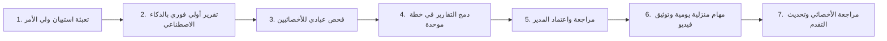

# دليل تجربة واستخدام المنصة (User & Flow Guide)
## منصة «تعاون» (Taawon) — منظومة التأهيل الذكي للتربية الخاصة

هذا الدليل يوضح التدفق التشغيلي الأساسي (Core User Flow) لاختبار المنظومة ونموذج العمل الأولي (Functional MVP) عبر الأدوار الثلاثة الحقيقية: **ولي الأمر**، **الأخصائي**، و**مدير المركز**.

---

### 1. بيانات الدخول السريع لاختبار المنصة
> **كلمة المرور الموحدة لجميع الحسابات:** `Taawon@2026`  
> يمكنك أيضاً الدخول بنقرة واحدة مباشرة من صفحة الدخول (`/login`) عبر أزرار الدخول السريع.

| الدور | البريد الإلكتروني | الاسم | الوظيفة في التجربة |
|---|---|---|---|
| **ولي الأمر** | `parent@taawon.app` | طارق المعايطة | متابعة الطفلين (سارة ويوسف)، تطبيق المهام اليومية، رفع الفيديوهات، واستشارة المساعد الذكي |
| **أخصائي نطق وتخاطب** | `speech@taawon.app` | أ. دينا حداد | كتابة التقرير العيادي وتحسين صياغته بالذكاء الاصطناعي |
| **أخصائي سلوكي** | `behavior@taawon.app` | أ. ليث الرواشدة | تقييم الفيديوهات المنزلية المرفوعة بالنجوم والملاحظات التوجيهية |
| **أخصائي تربية خاصة** | `specialed@taawon.app` | أ. هبة بني هاني | جدولة الجلسات وإدارة أهداف التربية الخاصة |
| **مدير المركز** | `admin@taawon.app` | د. بشير الخصاونة | لوحة التحكم الإدارية، إسناد الكوادر، وتوليد واعتماد الخطط العلاجية |

---

### 2. تدفق الاستخدام الأساسي (Core User Flow)

---

### 3. سيناريوهات التجربة العملية خطوة بخطوة

#### أ. تجربة ولي الأمر (Parent Journey)
1. **لوحة التحكم الرئيسية (`/parent`):**
   - استعراض شريط مراحل التأهيل (الاستبيان -> التقييم -> الاعتماد -> المهام النشطة).
   - التبديل بين الأبناء بسلاسة من القائمة العلوية (`Child Switcher`).
2. **المهام اليومية المنزلية (`/parent/tasks`):**
   - استعراض المهام الـ 3 المحددة لهذا الأسبوع من الخطة العلاجية.
   - الضغط على "طريقة التطبيق خطوة بخطوة" لرؤية الإرشادات المبسطة.
   - الضغط على "رفع فيديو توثيقي" لرفع مقطع أداء الطفل للمهمة مع ملاحظة نصية.
3. **المساعد الذكي للأسرة (`/parent/chat`):**
   - طرح أي استفسار حول سلوكيات الطفل أو كيفية التعامل مع نوبات الغضب أو تمارين النطق.
   - تجربة الأزرار السريعة المجهزة والحصول على إجابات سريرية واضحة فوراً.
4. **مكتبة التعلم المنزلي (`/parent/learning`):**
   - استعراض التمارين والأنشطة المقسمة حسب المجالات (نطق، سلوك، إدراكي، مهارات حياتية).
   - النقر على أي نشاط لرؤية خطوات التطبيق خطوة بخطوة، الأدوات المنزلية المتوفرة، ونصيحة الأخصائي.
   - تسجيل إنجاز النشاط وتتبعه.
5. **مؤشرات التطور والتقدم (`/parent/progress`):**
   - رؤية النسبة المئوية الدقيقة لتطور الطفل (تحسب آلياً: 70% تقييمات الأخصائيين + 30% التزام الأسرة بالمهام).
   - مخطط الرادار لمجالات المهارات، ومنحنى التقدم الأسبوعي.

---

#### ب. تجربة الأخصائيين (Specialist Journey)
1. **لوحة العمل (`/specialist`):**
   - الاطلاع على قائمة المهام العاجلة (فيديوهات بانتظار التقييم، أطفال بانتظار التقرير العيادي).
2. **ملف الطفل وإعداد التقرير (`/specialist/children/[id]`):**
   - الاطلاع على إجابات الاستبيان وتحليل الذكاء الاصطناعي الأولي.
   - الانتقال لتبويب "تقريري العيادي" وكتابة مسودة التقييم.
   - تجربة زر **«تحسين الصياغة بالذكاء الاصطناعي ✨»** لتحويل الملاحظات المختصرة إلى تقرير طبي رصين بصياغة سريرية احترافية.
3. **مراجعة وتصحيح الفيديوهات المنزلية (`/specialist/reviews`):**
   - مشاهدة مقطع الفيديو الذي رفعه ولي الأمر لأداء المهمة.
   - تحديد التقييم بالنجوم (1 إلى 5) وإضافة تغذية راجعة توجيهية للأسرة.
   - بمجرد الحفظ يتم تحديث نقاط تقدم الطفل تلقائياً.
4. **جدولة الجلسات (`/specialist/sessions`):**
   - استعراض أجندة الجلسات وإضافة موعد جلسة حضورية أو عن بعد للطفل وولي أمره.

---

#### ج. تجربة مدير المركز (Center Director Journey)
1. **لوحة المؤشرات الإدارية (`/admin`):**
   - نظرة شاملة على متوسط تقدم الأطفال في المركز ومخطط الرادار العام للأداء.
   - تنبيهات الخطط التي تنتظر المراجعة والاعتماد.
2. **إدارة الأطفال والكوادر (`/admin/children` & `/admin/specialists`):**
   - تسجيل طفل جديد وتعيين فريق الأخصائيين المسؤولين عن حالته.
3. **صياغة واعتماد الخطة العلاجية (`/admin/plans/[id]`):**
   - استعراض الخطة الموحدة لـ 12 أسبوعاً الناتجة عن دمج تقارير الأخصائيين.
   - اتخاذ القرار:
     - **اعتماد الخطة فوراً:** يُنشئ تلقائياً المهام اليومية في حساب ولي الأمر ويبدأ جدول المتابعة.
     - **طلب تعديل بالذكاء الاصطناعي:** كتابة ملاحظات المدير (مثل: *"ركز أكثر على التواصل البصري في الأسابيع الأولى"* ) ليقوم الذكاء الاصطناعي بإعادة صياغة الخطة وحفظ النسخة في سجل النسخ (Version History).
     - **إعادة للأخصائي:** لإضافة المزيد من الفحوصات السريرية.

---

### 4. مزايا الخصوصية والتشغيل
- **الخصوصية التامة (Zero PII):** كافة أسماء الأطفال والبيانات التعريفية تُعالج مشفرة ولا يتم إرسالها لنماذج الذكاء الاصطناعي.
- **التوافق اللغوي:** يدعم الواجهة العربية والإنجليزية مع اتجاهات RTL و LTR متطابقة ومنظمة.
- **الاعتمادية المستمرة:** في حال غياب مفتاح API الخارجي، يعمل النظام بوضع محاكاة عيادي عالي الجودة لضمان استمرارية تجربة الاستخدام دون أي توقف.
